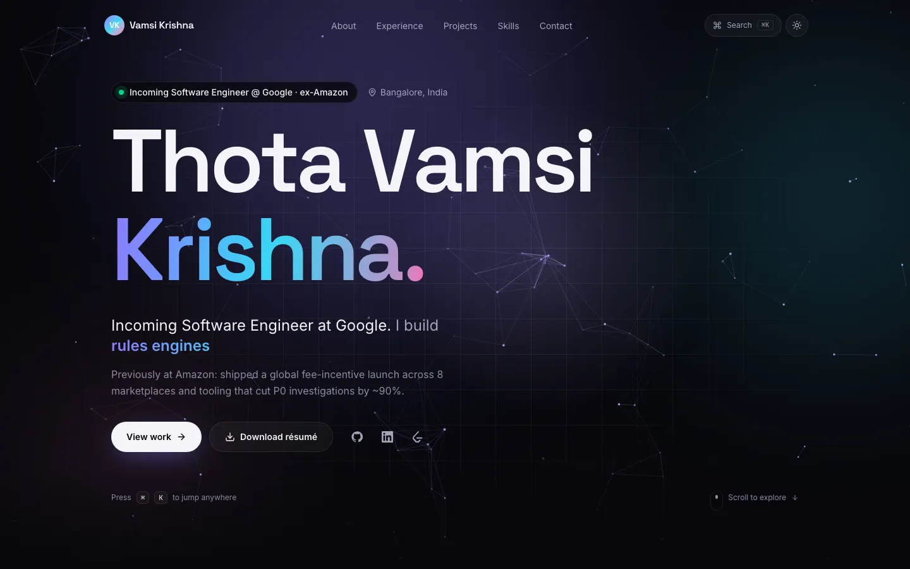
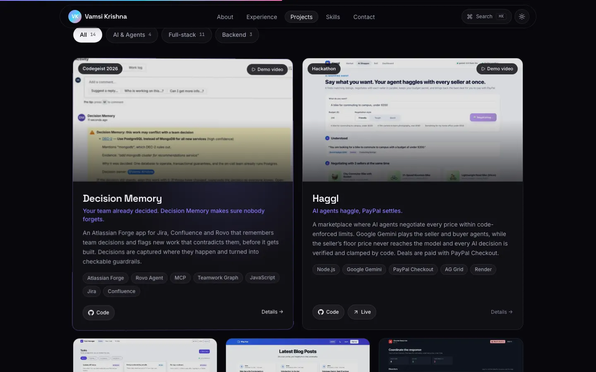
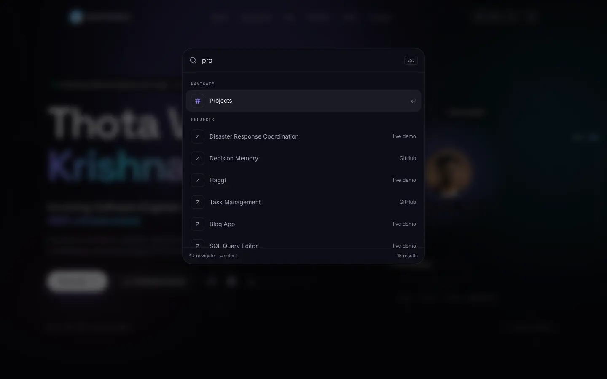
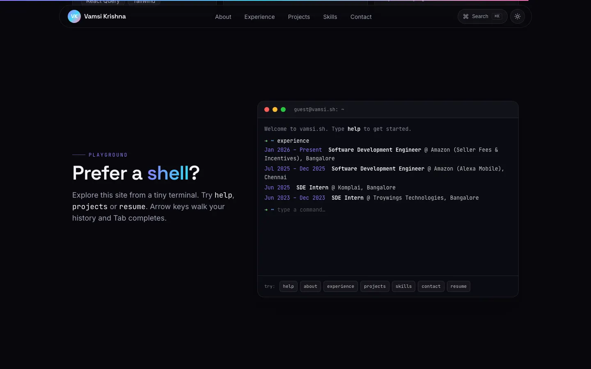
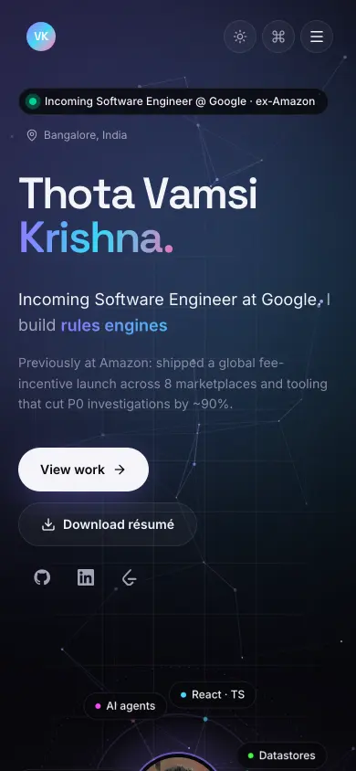

# Thota Vamsi Krishna · Portfolio

Personal site of **Thota Vamsi Krishna**, incoming Software Engineer at Google (Nov 2026) and ex-Amazon, based in Bangalore. It's a dark, interactive single-page portfolio built with Vite, React 18, TypeScript, Tailwind CSS and Framer Motion.


**Live:** https://portfolio-beryl-nine-58.vercel.app



## Features

- **Interactive hero.** A canvas "constellation" field reacts to the cursor like a gravity well. The name animates in letter by letter, a rotating word cycles through what I build, the call-to-action buttons are magnetic, and a status pill shows *Incoming Software Engineer @ Google · ex-Amazon*.
- **Command palette (⌘K / Ctrl+K).** Fuzzy search to jump to a section, open GitHub, LinkedIn, LeetCode or any project, copy the email address, toggle the theme, or download the résumé. It works fully from the keyboard.
- **Terminal widget.** A small shell with `help`, `about`, `experience`, `projects`, `skills`, `education`, `contact`, `resume`, `goto <section>`, `theme` and `clear`. It keeps command history (↑/↓) and has Tab completion.
- **Bento About section.** Photo and bio, next role, a live Bangalore clock, animated stat counters (8 marketplaces, ~90% faster investigations, 512 EC2 instances, 1000+ problems), education and achievements.
- **Experience timeline.** The line fills as you scroll. Each role has tech chips and expandable highlights.
- **Projects.** Filter chips (All / AI & Agents / Full-stack / Backend) with animated layout changes, 3D tilt and a cursor spotlight on the cards, and a detail modal with screenshot, description, stack, GitHub and live links, plus a click-to-load YouTube demo.
- **Skills.** Two marquee rows plus grouped chip cards you can tap to highlight.
- **Contact.** An EmailJS form with validation and status messages, a `mailto:` fallback and a copy-email button.
- **Polish.** Light/dark theme (dark by default, saved in `localStorage`, no flash on load), a sticky glass navbar that highlights the active section, a scroll progress bar, and toasts.

| Projects | Command palette | Terminal | Mobile |
| --- | --- | --- | --- |
|  |  |  |  |

## Quality

- **Accessibility:** semantic landmarks, a skip link, visible focus rings, native `<dialog>` modals (focus containment, Esc to close, focus returned to the opener), an ARIA combobox/listbox for the palette, `aria-pressed` filters and `aria-expanded` disclosures, and alt text on every image.
- **Reduced motion:** with `prefers-reduced-motion` the canvas draws one static frame, the marquee and rotating words stop, and reveal and tilt effects are turned off.
- **Performance:** the canvas, command palette, terminal, project modal, EmailJS SDK and Framer Motion feature bundle are all code-split and lazy-loaded. Images are WebP with `srcset` and lazy loading. Fonts are self-hosted with `@fontsource-variable`. The canvas pauses when it is off-screen or the tab is hidden.
- **SEO:** title, meta description, canonical URL, Open Graph and Twitter card (`public/og-image.png`), JSON-LD `Person` data, favicon set, web manifest, `robots.txt` and `sitemap.xml`.
- **Lighthouse** (local production preview): Desktop scores 100 for Performance, Accessibility, Best Practices and SEO. Mobile (simulated slow 4G) scores ~93 for Performance and 100 for the other three.

## Tech stack

| Area | Tools |
| --- | --- |
| Build | Vite 8, TypeScript (strict), ESLint (typescript-eslint, react-hooks) |
| UI | React 18, Tailwind CSS 4, Framer Motion (`LazyMotion`), lucide-react icons |
| Email | EmailJS (`@emailjs/browser`) |
| Hosting | Vercel (`framework: vite`, output `dist`, Node 22.x) |

## Project structure

```
src/
  data/profile.ts        # all content: bio, experience, projects, skills, links
  config/site.ts         # EmailJS public IDs (overridable with VITE_* env vars)
  sections/              # Hero, About, Experience, Projects, Skills, TerminalSection, Contact
  components/            # Navbar, CommandPalette, Terminal, HeroCanvas, Dialog, ProjectModal, …
  hooks/                 # active section, media queries, pointer spotlight/tilt
  lib/                   # app context (theme, palette, toasts), helpers
public/
  projects/              # project screenshots (WebP, 1200w + 640w)
  images/                # profile photo
  Thota_Vamsi_Krishna_Resume.pdf
```

To update the site, edit `src/data/profile.ts`. No component changes are needed.

## Run locally

Requires Node 22.

```bash
npm install
npm run dev        # http://127.0.0.1:5173
npm run build      # type-check + production build into dist/
npm run preview    # serve dist/ on http://127.0.0.1:4173
npm run lint
npm run typecheck
```

The dev and preview servers listen on loopback (`127.0.0.1`) by default.

### Environment variables (optional)

The EmailJS service, template and public key are **public client-side identifiers**, not secrets: they are sent from the browser on every request. The current values are committed as defaults in `src/config/site.ts`. To point the form at a different EmailJS account, set these (see `.env.example`):

| Variable | Purpose |
| --- | --- |
| `VITE_EMAILJS_SERVICE_ID` | EmailJS service ID |
| `VITE_EMAILJS_TEMPLATE_ID` | EmailJS template ID (uses `from_name`, `from_email`, `subject`, `message`) |
| `VITE_EMAILJS_PUBLIC_KEY` | EmailJS public key |

## Deploy

Vercel builds from `main`. `vercel.json` sets `framework: vite`, `buildCommand: npm run build` and `outputDirectory: dist`, adds long-lived cache headers for hashed assets and a few security headers. The site is a single page with no client routing, so it needs no SPA rewrites.

## License

Personal portfolio. The code may be used for reference; the content and photos belong to Thota Vamsi Krishna.
