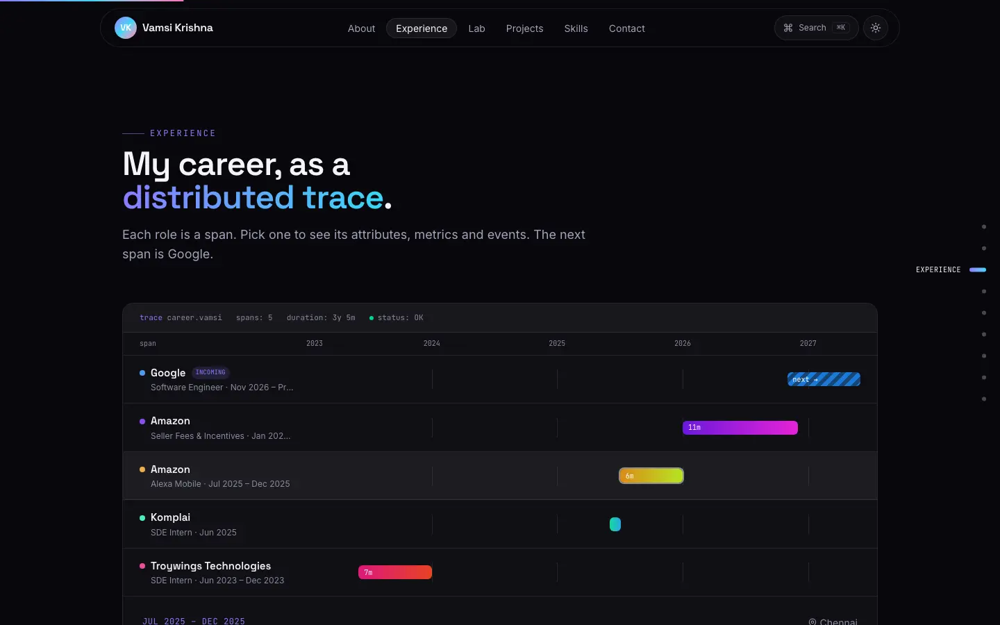
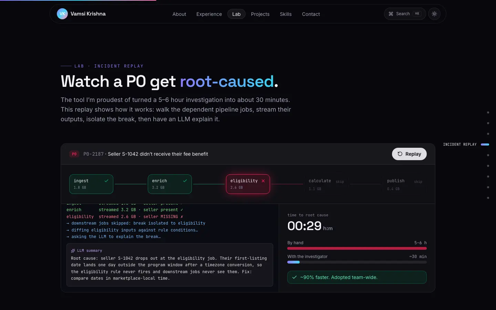
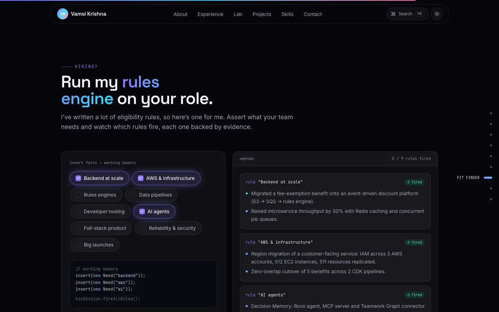
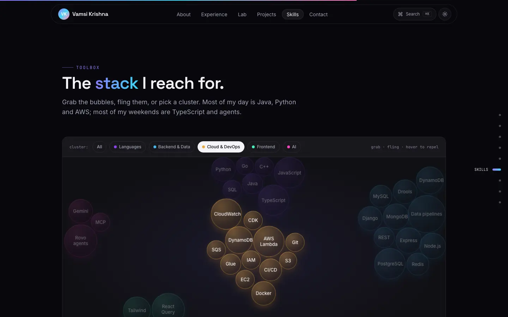

# Thota Vamsi Krishna · Portfolio

Personal site of **Thota Vamsi Krishna**, incoming Software Engineer at Google (Nov 2026) and ex-Amazon, based in Bangalore. It's a dark, interactive single-page portfolio built with Vite, React 18, TypeScript, Tailwind CSS and Framer Motion.


**Live:** https://portfolio-beryl-nine-58.vercel.app


## Features

The site treats a backend engineer's career like a running system you can poke at.

- **Hero "system map".** I sit at the centre as `vamsi.service`, with my stack (Java, Python, AWS, rules engines, data pipelines, AI agents, React/TS, datastores) orbiting as dependencies. Requests flow along the edges as glowing packets. You can hover or focus a node to see what it covers, or drag it and watch it spring back. Behind it, a cursor-reactive constellation canvas. The name animates in letter by letter, the role words rotate, the CTAs are magnetic, and a status pill reads *Incoming Software Engineer @ Google · ex-Amazon*.
- **Career as a distributed trace.** Each role is a span on a 2023–2027 time axis. Google shows as a striped "incoming" span. Selecting a span opens its attributes, metrics (e.g. `marketplaces=8`, `ec2_instances=512`) and events. It's a keyboard-navigable tablist.
- **Lab: incident replay.** A playable, fictional replay of the P0 investigator CLI. It walks five pipeline jobs, streams their outputs, isolates the failing job, types out an LLM root-cause summary and compares time to root cause (5–6 h by hand vs ~30 min).
- **Fit finder.** A Drools-flavoured rules engine for recruiters. Toggle what the role needs and the matching rules "fire", each backed by real evidence from my work, then mail the match to me in one click.
- **Skill field.** A hand-rolled force simulation: every skill is a bubble you can grab and fling. Bubbles collide, shy away from the cursor and re-cluster when you pick a group.
- **Projects.** Live GitHub stats (public repos, language mix, latest pushes) from the public API. Filter chips (All / AI & Agents / Full-stack / Backend), tilt and spotlight cards, and a detail modal with screenshot, stack, links and a click-to-load YouTube demo.
- **Command palette (⌘K / Ctrl+K).** Jump anywhere, run the incident replay, open links or projects, copy the email address, toggle the theme, or get the résumé.
- **Terminal.** `help`, `about`, `experience`, `projects`, `skills`, `education`, `contact`, `resume`, `replay`, `fit`, `goto <section>`, `theme`, `clear`, with history and Tab completion.
- **Bento About section** with photo, the next role, a live Bangalore clock and animated counters. **Contact** is an EmailJS form with a `mailto:` fallback and copy-email.
- **Polish.** Light/dark theme, a glass navbar with active-section highlight, a desktop section rail, a scroll progress bar and toasts. There's also a hidden Konami-code easter egg (↑↑↓↓←→←→BA).

| Career trace | Incident replay | Fit finder |
| --- | --- | --- |
|  |  |  |

| Skill field | Projects | Command palette | Mobile |
| --- | --- | --- | --- |
|  |  |  |  |

## Quality

- **Accessibility:** semantic landmarks, a skip link, visible focus rings, native `<dialog>` modals (focus containment, Esc to close, focus returned to the opener), an ARIA combobox/listbox for the palette, `aria-pressed` filters and `aria-expanded` disclosures, and alt text on every image.
- **Reduced motion:** with `prefers-reduced-motion` the canvases draw a static frame, the system map stops orbiting, the skill field settles once and stops, the rotating words stop, and reveal, tilt and confetti effects are turned off.
- **Performance:** the canvas, command palette, terminal, incident replay, skill field, project modal, EmailJS SDK and Framer Motion feature bundle are all code-split and lazy-loaded. Images are WebP with `srcset` and lazy loading. Fonts are self-hosted with `@fontsource-variable`. The canvas pauses when it is off-screen or the tab is hidden.
- **SEO:** title, meta description, canonical URL, Open Graph and Twitter card (`public/og-image.png`), JSON-LD `Person` data, favicon set, web manifest, `robots.txt` and `sitemap.xml`.
- **Lighthouse** (local production preview): Desktop scores 100 for Performance, Accessibility, Best Practices and SEO. Mobile (simulated slow 4G) scores ~91 for Performance and 100 for the other three.

## Tech stack

| Area | Tools |
| --- | --- |
| Build | Vite 8, TypeScript (strict), ESLint (typescript-eslint, react-hooks) |
| UI | React 18, Tailwind CSS 4, Framer Motion (`LazyMotion`), lucide-react icons |
| Email | EmailJS (`@emailjs/browser`) |
| Hosting | Vercel (`framework: vite`, output `dist`, Node 22.x) |

## Project structure

```
src/
  data/profile.ts        # all content: bio, experience, projects, skills, links
  config/site.ts         # EmailJS public IDs (overridable with VITE_* env vars)
  sections/              # Hero, About, Experience (trace), Lab, Projects, Skills, FitFinder, TerminalSection, Contact
  components/            # SystemMap, IncidentReplay, SkillField, GitHubPulse, CommandPalette, Terminal, …
  hooks/                 # active section, media queries, pointer spotlight/tilt
  lib/                   # app context (theme, palette, toasts), helpers
public/
  projects/              # project screenshots (WebP, 1200w + 640w)
  images/                # profile photo
  Thota_Vamsi_Krishna_Resume.pdf
```

To update the site, edit `src/data/profile.ts`. No component changes are needed.

## Run locally

Requires Node 22.

```bash
npm install
npm run dev        # http://127.0.0.1:5173
npm run build      # type-check + production build into dist/
npm run preview    # serve dist/ on http://127.0.0.1:4173
npm run lint
npm run typecheck
```

The dev and preview servers listen on loopback (`127.0.0.1`) by default.

### Environment variables (optional)

The EmailJS service, template and public key are **public client-side identifiers**, not secrets: they are sent from the browser on every request. The current values are committed as defaults in `src/config/site.ts`. To point the form at a different EmailJS account, set these (see `.env.example`):

| Variable | Purpose |
| --- | --- |
| `VITE_EMAILJS_SERVICE_ID` | EmailJS service ID |
| `VITE_EMAILJS_TEMPLATE_ID` | EmailJS template ID (uses `from_name`, `from_email`, `subject`, `message`) |
| `VITE_EMAILJS_PUBLIC_KEY` | EmailJS public key |

## Deploy

Vercel builds from `main`. `vercel.json` sets `framework: vite`, `buildCommand: npm run build` and `outputDirectory: dist`, adds long-lived cache headers for hashed assets and a few security headers. The site is a single page with no client routing, so it needs no SPA rewrites.

## License

Personal portfolio. The code may be used for reference; the content and photos belong to Thota Vamsi Krishna.
